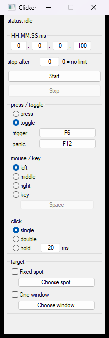

# Clicker

A small Windows auto-clicker. The idea comes from [Boris Mezhibovskiy](#what-changed-from-boriss-program)'s clicker: pick how fast to click, pick a trigger key, and optionally stop after a set number of clicks. This program keeps that shape and changes how timing, input, and targeting work.

Use it on your own machine, at your own risk.

<p align="center">
  
</p>

## Download

64-bit Windows builds are on the [releases](https://github.com/lecrackzor/clicker/releases) page. Versions before 1.0 are test builds.

## Usage

Run `clicker.exe`. The gap between clicks is hours, minutes, seconds, and milliseconds. `0` in **stop after** means keep going until you stop it.

| Control | Default |
| --- | --- |
| Trigger | F6, toggle |
| Panic | F12 |
| Button | Left |
| Hold | 20 ms |

Press the trigger to start. Press it again, click **Stop**, or hit the panic key to stop. The trigger still works while the window is minimized. Close the program to give the keys back.

**Choose spot** records a fixed screen position. **Choose window** limits clicks to that window. Settings are saved in `%LOCALAPPDATA%\Clicker\settings.ini`.

## What changed from Boris's program

Boris's clicker took a click count, a frequency in clicks per second (fractions allowed, up to 9999), and one trigger key that defaulted to Enter. A last field stopped the run after N clicks, with 0 meaning forever. The trigger kept working while the window was minimized, and closing the program was how you gave the key back.

This version changes the following.

- **Interval instead of a rate.** The gap between clicks is hours, minutes, seconds, and milliseconds. One click every two seconds is `00:00:02:000`, which is what `0.5` clicks per second meant before.
- **The button is held for a set time.** Each press stays down for the hold time (20 ms by default), then releases. If the interval is shorter than that click, the interval is lengthened and the window says so, so the next press does not land while the button is still down.
- **Single, double, or hold.** Hold keeps the button down until you stop, instead of repeating clicks.
- **Mouse or keyboard.** Left, middle, or right button, or a key (Space by default). Mouse 4 and mouse 5 count as keys. Keyboard actions are sent as scan codes.
- **Trigger and panic are separate keys.** The trigger defaults to F6 and can toggle, or run only while held. Panic defaults to F12 and always stops. Either key can be changed without restarting, including when the click button is the left mouse button.
- **The trigger is not a mouse button.** The click button and the trigger cannot be the same physical button. If the action key matches the trigger or the panic key, the run will not start.
- **Stop after N is still 0 for no limit.** Start and Stop sit next to the hotkeys. Hotkeys keep working while the window is minimized. Closing the program releases them.
- **Optional target.** A fixed screen spot, or a lock to one window. With the lock on, clicks happen only while the pointer is over that window, and hold mode lets go when the pointer leaves.
- **Settings stick.** They are saved in `%LOCALAPPDATA%\Clicker\settings.ini`.
- **The status line reports the run.** Idle, running (click count and clicks per second), holding, panic, or stopped. Controls lock while a run is going.

## Build

Requires Visual Studio 2022 with the C++ tools (Community or Build Tools).

```bat
build.bat
```

That writes `build\clicker.exe`.

Check timing without clicking anything:

```bat
build\clicker.exe --self-test
```

The log is `build\selftest.log`. It passes when 60 clicks at a 50 ms interval and a 20 ms hold stay within 2 ms.
